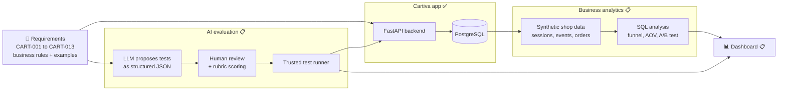
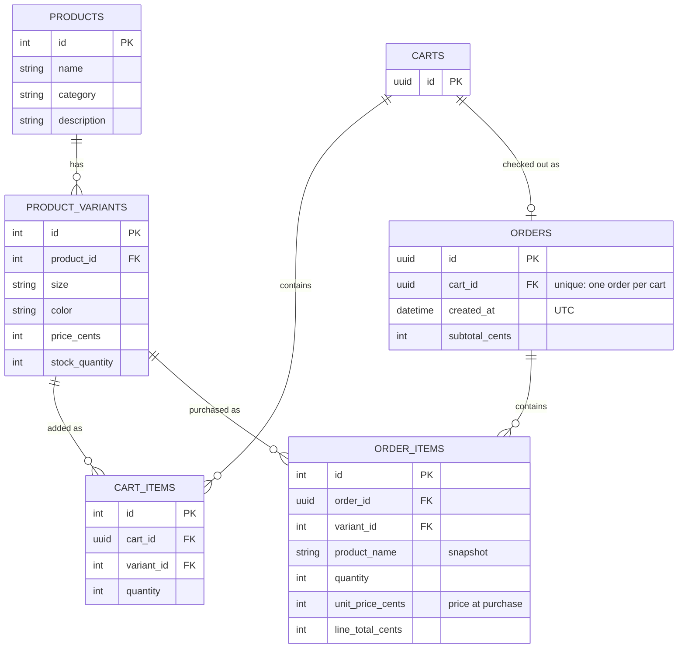
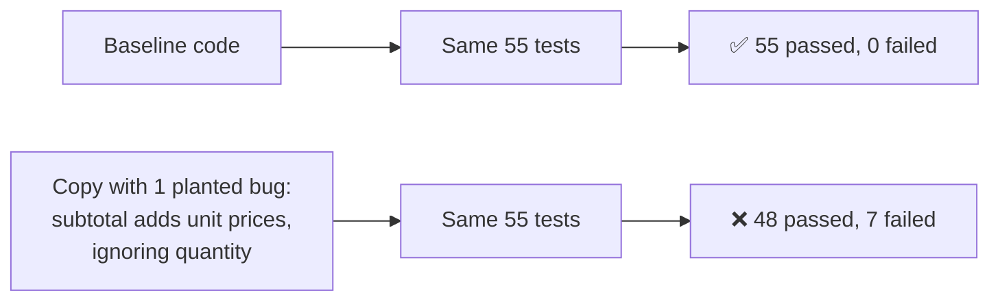
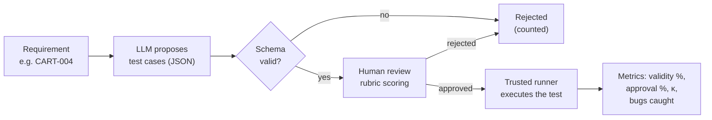

# Cartiva: E-commerce Analytics & AI Test-Evaluation Project

[](https://github.com/RuchaPanhale/ai-software-testing-platform/actions/workflows/tests.yml)

> **I measured an e-commerce product, and I measured an AI that tests it.**

Cartiva is a fictional fashion store. I wrote its business rules
(pricing, discounts, shipping, stock, search) as numbered requirements, built
a tested backend that enforces them, and use it as a controlled environment
for two kinds of analysis:

1. **Business analytics:** how shoppers move from browsing to buying, and
   whether a discount code actually changes behavior.
2. **AI evaluation:** how good LLM-generated test cases really are, measured
   against human judgment and against bugs I plant on purpose.

A personal portfolio project by **Rucha Panhale** (MS Computer Science, AI track),
built to demonstrate data modeling, SQL, experiment design, and AI-evaluation skills.

LinkedIn : https://www.linkedin.com/in/rucha-panhale/

---

## Project status

| Area | Status |
|---|---|
| Business rules written as testable requirements (CART-001 to CART-013) | ✅ Done |
| Backend: catalog, search, filters, cart, order tables | ✅ Done |
| 55 automated test cases + CI on every push | ✅ Done |
| Controlled regression experiment (1 planted defect) | ✅ Done |
| Pricing rules: WELCOME10 discount, shipping, totals | 🔜 Next |
| Synthetic shop data + SQL analysis + A/B test | 📋 Planned |
| Mutation suite (10–15 planted defects) | 📋 Planned |
| LLM test-proposal evaluation | 📋 Planned |
| Streamlit + Tableau dashboards | 📋 Planned |

Only items marked ✅ are built and verified. Everything else is a plan, not a result.

---

## How it fits together



The **requirements document** is the anchor. The app enforces it, the tests
check it, and the AI's proposals are judged against it.

---

## Questions this project answers

**Business (data analyst)** — 📋 planned
- Where do shoppers drop off between viewing a product, adding to cart, and ordering?
- Which categories have the highest cart-abandonment rate?
- What is the average order value, and how does it vary by category?
- **Does the WELCOME10 code increase conversion?** Run as an A/B test with a
  significance test, not eyeballed from a chart.

**AI evaluation** — 📋 planned
- What share of LLM-proposed test cases are valid, relevant, correct, and in scope?
- Do two human raters agree on what a "good" proposal is (Cohen's kappa)?
- Does an LLM judge agree with human labels? Where does it disagree?
- **Do AI-proposed tests catch planted bugs** as well as hand-written tests?

---

## What's built

### 1. Business rules as testable requirements

[`docs/cartiva-requirements.md`](docs/cartiva-requirements.md) defines 13
requirements with acceptance examples, including the edge cases:

| Rule | Example |
|---|---|
| WELCOME10: 10% off, minimum $50.00, capped at $20.00 | A $49.99 cart is ineligible; $250.00 gets the capped $20.00 off |
| Rounding: half-cents round up | $50.05 gets $5.01 off |
| Free shipping only **above** $100.00 after discounts | Exactly $100.00 still pays $5.99 |
| Search must not mix colors from different variants | "green black shirt" doesn't match a shirt sold separately in green and in black |

These rules are the ground truth for the tests and for the AI evaluation.

### 2. A data model built for trustworthy data



Design choices that matter for analysis:
- **Money is stored as integer cents** (e.g. $19.99 = 1999), so totals never
  suffer floating-point rounding errors.
- **Order items keep a snapshot** of product name, size, color and price at the
  time of purchase. Later catalog price changes don't rewrite sales history.
- **The database rejects bad data itself**, through check constraints: no
  negative prices or stock, no zero quantities, no blank names, and
  `line_total = unit_price × quantity` is enforced on every order line.
- **Prices are calculated on the server**, so a client can't send its own price.
- **Two database roles:** an owner role runs migrations, and the app connects
  through a restricted role with only the permissions it needs.

### 3. Automated tests and CI

- **55 test cases** across 28 test functions cover catalog, search, filters,
  and cart behavior: stock limits, invalid quantities, missing records, price
  tampering, and carts that are already checked out.
- Each test gets a **fresh, isolated database**, so tests never depend on
  each other or on local data.
- **GitHub Actions runs on every push and pull request:** it applies all
  database migrations to a fresh PostgreSQL instance, checks that the models
  and the database schema haven't drifted apart, runs the tests, and saves a
  JUnit XML results file.

### 4. Controlled regression experiment

To check that the tests catch real bugs, I ran the same suite against two
copies of the code:



| Version | Passed | Failed |
|---|---:|---:|
| Baseline (commit `ef3acb4`) | 55 | 0 |
| Planted subtotal bug | 48 | 7 |

**Finding:** 7 tests caught the bug. For example, a two-item cart that should
total 5998 cents returned 2999 cents.

**What this does not show:** one planted bug can't tell you how good the test
suite is in general. That's why the next step is a mutation suite of 10–15
different planted bugs, measured as "caught X of Y."

Reproduce it with `python scripts/regression_demo.py`.

---

## AI evaluation design (planned)



**Hard rule:** the LLM never writes code that gets executed. It only produces
structured, schema-validated proposals (endpoint, input, expected result).
A human approves each one, and a hand-written runner executes approved
proposals. Pass or fail comes from real test results, never from the AI's opinion.

Planned measurements:
- **Rubric:** schema-valid, linked to the right requirement, correct expected
  result, in scope, not a duplicate, would catch a defect
- **Inter-rater agreement** (Cohen's kappa) between two human raters
- **LLM-as-judge vs human labels**
- **Prompt or model comparison**
- **Defect catch rate:** AI-proposed tests vs hand-written tests, against the mutation suite

---

## Tech stack

| Purpose | Tools |
|---|---|
| Data & storage | PostgreSQL 18 (Docker), SQLModel, Alembic migrations |
| Backend | Python 3.11, FastAPI, Pydantic |
| Testing & CI | pytest, GitHub Actions, JUnit XML |
| Analysis (planned) | SQL, pandas, Streamlit, Tableau Public |

---

## Quick start

```bash
# 1. Start PostgreSQL (Docker Desktop must be running)
cp .env.example .env          # then set your own local passwords
docker compose up -d postgres

# 2. Set up Python
python3.11 -m venv .venv
source .venv/bin/activate
python -m pip install -r cartiva/backend/requirements.txt

# 3. Run the tests (no database needed: tests use isolated in-memory databases)
python -m pytest cartiva/backend/tests -v
```

Full setup (database roles, migrations, permissions, seed data):
[`docs/setup.md`](docs/setup.md).
Endpoint behavior and status codes: [`docs/api.md`](docs/api.md).

---

## Quality principles

- Run tests against real application logic or APIs.
- Review AI-generated test suggestions before execution.
- Never execute arbitrary AI-generated code.
- Base dashboards on stored execution results.
- Keep requirements, tests, runs, and defects isolated by application.
- Distinguish application failures from execution infrastructure errors.

## Known limitations

- **Tests run on SQLite, not PostgreSQL.** PostgreSQL-specific behavior
  (row locking under concurrency, permissions) was checked manually, not in
  automated tests.
- **Concurrency was smoke-tested once by hand:** two simultaneous requests for
  5 units each against stock of 8. One succeeded, one was rejected, and the
  stored quantity stayed 5.
- **Not built:** checkout, inventory deduction, guest-session cookies, and
  duplicate-checkout protection (CART-008, CART-009, CART-011). These are
  outside the current scope.
- **Tests are not yet tagged with requirement IDs**, so requirement-level
  coverage can't be reported automatically yet.
- **Planned shop data will be synthetic.** Findings from it will demonstrate
  metric design and method, not real customer behavior.

## Roadmap

1. Pricing rules: WELCOME10, shipping, final totals (CART-004 to CART-006)
2. Synthetic shop data with a fixed random seed and documented assumptions
3. SQL analysis + findings memo
4. Mutation suite: 10–15 planted defects
5. LLM test-proposal evaluation
6. Streamlit dashboard (business, AI eval, test health) + Tableau Public