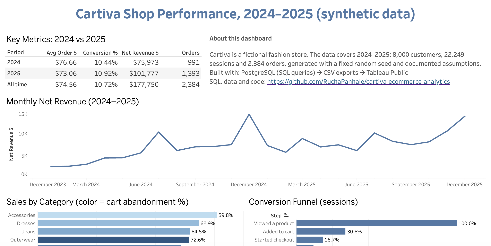
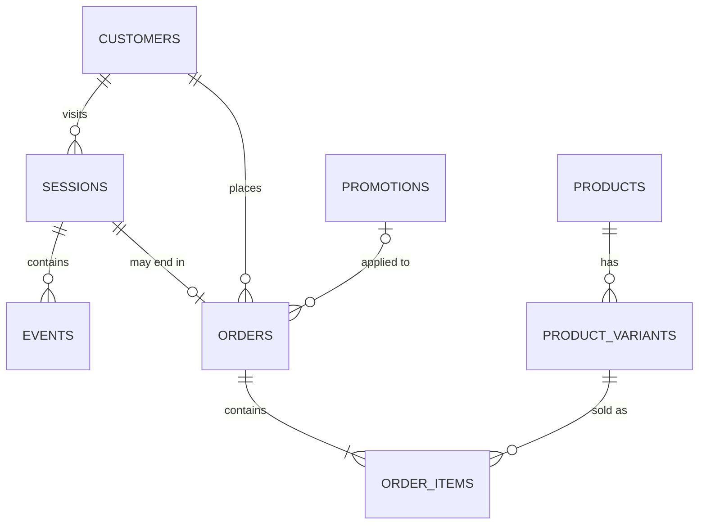
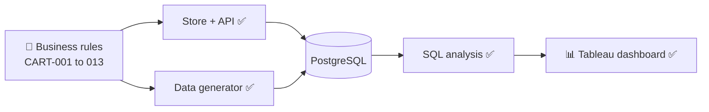

# Cartiva: E-commerce Analytics Case Study (SQL + Tableau)

[](https://github.com/RuchaPanhale/ai-software-testing-platform/actions/workflows/tests.yml)

Cartiva is a fictional online fashion store that I built as an end-to-end
data analytics project. I defined its business rules (pricing, discounts,
shipping), generated two years of realistic shop activity (8,000 customers, 2,384 orders, including a randomized A/B test of a discount code), analyzed it with SQL in PostgreSQL, and turned the results into an interactive Tableau dashboard with key findings.

## Questions I answered

- How did revenue, orders and average order value change from 2024 to 2025?
- Where in the funnel do shoppers drop off between browsing and buying?
- Which product categories sell most, and which are most often abandoned in the cart?
- Did the WELCOME10 discount get more new customers to buy, and is the
  difference statistically significant?
- What do sitewide sales do to traffic, orders and order size?

**Skills demonstrated:** SQL (CTEs, joins, window functions, aggregation) ·
KPI and metric definition · funnel and cohort-style analysis · A/B testing and
statistical significance · data modeling and data-quality validation ·
Tableau dashboard design · communicating findings

A portfolio project by **Rucha Panhale** (MS Computer Science, AI track) ·
[LinkedIn](https://www.linkedin.com/in/rucha-panhale/)

## Dashboard

### 📊 [View the live dashboard on Tableau Public](https://public.tableau.com/app/profile/rucha.panhale/viz/CartivaShopPerformance/CartivaDashboard)

[](https://public.tableau.com/app/profile/rucha.panhale/viz/CartivaShopPerformance/CartivaDashboard)

> Cartiva is a fictional store and its data is **synthetic**: generated with a
> fixed random seed and fully documented assumptions
> ([`docs/data-assumptions.md`](docs/data-assumptions.md)). The findings
> demonstrate analysis method, not real customer behavior.

---

## Key findings

1. **Revenue grew 34% in 2025** ($75,973 → $101,777), driven by more orders
   (+41%), not bigger ones: average order value fell from $76.66 to $73.06.
2. **Only 30.6% of sessions add anything to the cart**, the biggest drop in
   the conversion funnel.
3. **Outerwear has the highest cart abandonment (72.6%)**; Accessories the
   lowest (59.8%).
4. **WELCOME10 raised the share of new customers who ordered** from 23.25% to
   26.89% (+3.64 points, z = 3.75, significant at the 5% level).
   *(Synthetic test with a disclosed built-in effect; it demonstrates the A/B
   method.)*

| Metric | 2024 | 2025 | All time |
|---|---:|---:|---:|
| Net revenue | $75,973 | $101,777 | $177,750 |
| Orders | 991 | 1,393 | 2,384 |
| Average order value | $76.66 | $73.06 | $74.56 |
| Conversion rate (orders ÷ sessions) | 10.44% | 10.92% | 10.72% |

---

## The analysis

Every result comes from a SQL file in [`analytics/queries/`](analytics/queries/),
run against PostgreSQL and exported to CSV for Tableau with
[`analytics/export_results.sh`](analytics/export_results.sh).

| Query | Business question | SQL techniques |
|---|---|---|
| [`02_kpis_by_year`](analytics/queries/02_kpis_by_year.sql) | How big is the business, and how did 2025 compare with 2024? | CTEs, `EXTRACT`, `UNION ALL`, explicit metric definitions |
| [`03_monthly_trend`](analytics/queries/03_monthly_trend.sql) | How do sessions, orders and revenue move month by month? | `DATE_TRUNC`, `LEFT JOIN` to keep months without orders, `COALESCE` |
| [`04_conversion_funnel`](analytics/queries/04_conversion_funnel.sql) | Where do shoppers drop off between browsing and buying? | `CASE` pivot per session, window functions `LAG` and `FIRST_VALUE` |
| [`05_category_performance`](analytics/queries/05_category_performance.sql) | Which categories sell, and which are abandoned in the cart? | Multi-table joins, share of total with `SUM() OVER ()` |
| [`06_welcome10_experiment`](analytics/queries/06_welcome10_experiment.sql) | Did a discount code bring in more first-time buyers? | `EXISTS`, `FILTER`, a two-proportion z-test written in SQL |
| [`07_sales_vs_normal_days`](analytics/queries/07_sales_vs_normal_days.sql) | What do sitewide sales do to traffic, orders and order size? | `GENERATE_SERIES` calendar spine, pre-aggregated joins, `NULLIF` |

**Metric definitions** are written at the top of each query. For example,
*net revenue* = subtotal − discount (shipping excluded), and *conversion
rate* = orders ÷ sessions.

**Performance:** query `07` first used a correlated subquery for every
calendar day (4 s). Rewriting it to aggregate sessions and orders once per day
and then join cut it to 0.035 s with identical results.

---

## The data



| Table | Rows | One row per |
|---|---:|---|
| customers | 8,000 | customer, with signup date, state, channel and A/B group |
| sessions | 22,249 | visit, with device and traffic channel |
| events | 80,178 | product view, add to cart, checkout start or purchase |
| orders | 2,384 | order, with subtotal, discount, shipping and total |
| order_items | 2,815 | product line in an order |
| products / variants / promotions | 36 / 87 / 5 | catalog item / size-color option / discount |

**What's in it:** a store that launches in January 2024, seasonality with a
December peak, Summer and Black Friday sales in both years, a randomized
WELCOME10 experiment, repeat customers and device differences.

**Built to be trustworthy:**
- **Documented:** every assumption, including the effects deliberately built
  in, is in [`docs/data-assumptions.md`](docs/data-assumptions.md); every
  column is in [`docs/data-dictionary.md`](docs/data-dictionary.md).
- **Reproducible:** the same random seed always produces byte-identical data.
- **Validated by the database:** primary keys, foreign keys and checks such as
  `total = subtotal − discount + shipping` and
  `line_total = unit_price × quantity` reject inconsistent rows.
- **Tested:** 20 automated tests check the pricing rules against the
  acceptance examples in the requirements, reproducibility, and referential
  integrity on every push.
- **Money in integer cents**, so totals never suffer floating-point rounding.

---

## Behind the data: the store and its business rules

Cartiva's rules (pricing, discounts, shipping, stock, search) are written as
13 numbered requirements with acceptance examples in
[`docs/cartiva-requirements.md`](docs/cartiva-requirements.md). For example:

| Rule | Edge case |
|---|---|
| WELCOME10: 10% off, minimum $50.00, capped at $20.00 | $49.99 is ineligible; $250.00 gets the capped $20.00 |
| Half-cents round up | $50.05 gets $5.01 off |
| Free shipping only **above** $100.00 after discounts | exactly $100.00 still pays $5.99 |

A FastAPI backend enforces these rules, and a small storefront at `/shop`
lets you browse the 36 products and add items to a bag.



**Engineering quality:**
- **79 automated tests:** 59 API tests (catalog, search, cart, stock limits,
  price tampering, checked-out carts, storefront) and 20 data tests.
- **CI on every push** (GitHub Actions): applies all database migrations to a
  fresh PostgreSQL 18 instance, checks for schema drift, and runs the tests.
- **Regression experiment:** with one deliberately planted bug, the test suite
  went from 55 passed to 48 passed and 7 failed, catching it.

Endpoint details: [`docs/api.md`](docs/api.md). Full setup:
[`docs/setup.md`](docs/setup.md).

---

## Project status

| Area | Status |
|---|---|
| Business requirements (CART-001 to CART-013) | ✅ Done |
| Store backend, storefront, 79 tests, CI | ✅ Done |
| Synthetic dataset (2 years) with documented assumptions | ✅ Done |
| SQL analysis (6 queries) | ✅ Done |
| Tableau Public dashboard + key findings | ✅ Done |
| Cohort / repeat-customer analysis | 📋 Planned |
| Policy changes over time with before/after analysis | 📋 Planned |
| Evaluation of LLM-generated test cases | 📋 Planned (later phase) |

---

## Quick start

```bash
# 1. Start PostgreSQL (Docker Desktop must be running)
cp .env.example .env          # then set your own local passwords
docker compose up -d postgres

# 2. Set up Python and run the tests
python3.11 -m venv .venv
source .venv/bin/activate
python -m pip install -r cartiva/backend/requirements.txt
python -m pytest cartiva/backend/tests analytics/tests -q

# 3. Load the shop data and export every query result as CSV
bash analytics/load_data.sh
bash analytics/export_results.sh

# 4. Open the store (after migrations and seeding: see docs/setup.md)
python -m uvicorn cartiva.backend.main:app --reload
#    then visit http://127.0.0.1:8000/shop/
```

## Tools

| Purpose | Tools |
|---|---|
| Analysis | PostgreSQL SQL (written in DBeaver), Tableau Public |
| Data | PostgreSQL 18 (Docker), Python data generator with a fixed seed |
| Store and backend | Python 3.11, FastAPI, SQLModel, Alembic |
| Testing and CI | pytest, GitHub Actions |
| AI assistant | Claude Code |

## How this was built

I wrote Cartiva's business requirements and policies, made the design and
data decisions, and reviewed and tested every change. I used **Claude Code**
as an AI coding assistant to write the application, backend, data
generator and storefront code, and to draft the first set of analysis
queries (`02`–`07` in `analytics/queries/`). I ran and verified every query
result, chose the metrics, built the Tableau dashboard and wrote the findings.

## Known limitations

- **The data is synthetic.** The WELCOME10 effect and the category
  differences were built into the generator on purpose and are disclosed;
  the analysis shows method, not real-world causes.
- **Conversion is higher than a typical store** (about 11% of sessions end in
  an order, versus roughly 2–5% in real e-commerce), because every visitor is
  a registered customer.
- **No returns, refunds or price changes** are modeled.
- **The storefront has no checkout**; orders in the dataset are generated,
  not placed through the store.
- **API tests run on SQLite**; PostgreSQL-specific behavior (row locking,
  permissions) was checked manually.

## Roadmap

1. Cohort and repeat-customer analysis
2. New promotions with effective dates, then a before/after analysis
3. Evaluation of LLM-generated test cases (rubric, human labeling,
   inter-rater agreement, defects caught)
