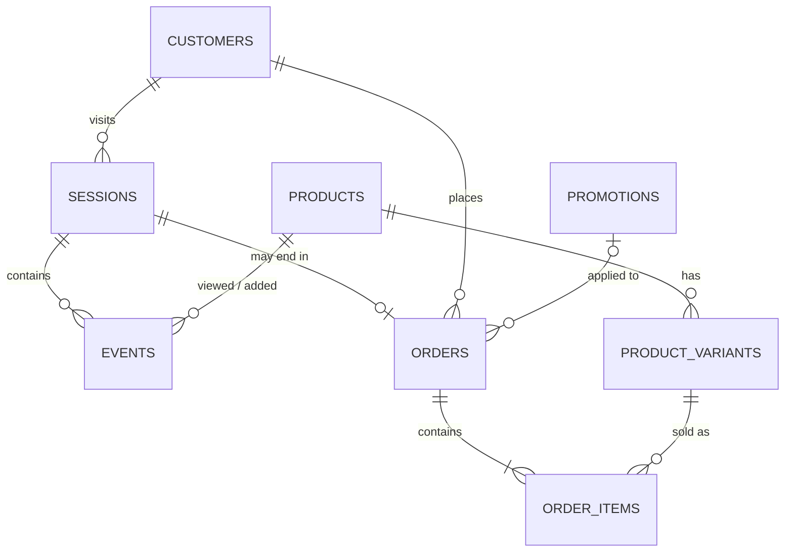

# Data Dictionary: `analytics` schema

The synthetic shop dataset, loaded into PostgreSQL by
[`analytics/load_data.sh`](../analytics/load_data.sh) and also available as
CSV files in [`analytics/data/`](../analytics/data/). How the data was
generated: [data-assumptions.md](data-assumptions.md).

Conventions:
- Money is **integer cents**: `8999` = $89.99. Divide by 100.0 for dollars.
- Timestamps are UTC, `timestamp without time zone`.
- An empty value in a CSV is `NULL` in the database.

## How the tables connect

## Tables

### `products`: one row per product (32 rows)
| Column | Type | Meaning |
|---|---|---|
| product_id | integer, PK | |
| name | text | e.g. "Wool Blend Coat" |
| category | text | Shirts, Tops, Dresses, Jeans, Knitwear, Outerwear, Shoes, Accessories |
| description | text | |

### `product_variants`: one row per size/color combination (77 rows)
| Column | Type | Meaning |
|---|---|---|
| variant_id | integer, PK | |
| product_id | integer, FK → products | |
| size | text | "S", "M", "30", "8", "One Size"… |
| color | text | |
| price_cents | integer | Price; constant over the whole period |

### `promotions`: one row per discount (5 rows)
| Column | Type | Meaning |
|---|---|---|
| promotion_code | text, PK | WELCOME10, SUMMER2024, BLACKFRIDAY2024, SUMMER2025, BLACKFRIDAY2025 |
| name | text | |
| promotion_type | text | `code` (customer enters it) or `automatic` (sitewide sale) |
| percent_off | integer | |
| min_subtotal_cents | integer | 0 = no minimum |
| max_discount_cents | integer | NULL = no cap |
| starts_on, ends_on | date | Inclusive |

### `customers`: one row per customer (8,000 rows)
| Column | Type | Meaning |
|---|---|---|
| customer_id | integer, PK | Assigned in signup order |
| signup_date | date | Also the date of their first session |
| state | text | Two-letter US state |
| acquisition_channel | text | How they first arrived: organic_search, paid_social, email, referral, direct |
| experiment_group | text | `control` or `treatment` (offered WELCOME10 for the first order) |

### `sessions`: one row per visit (~22,000 rows)
| Column | Type | Meaning |
|---|---|---|
| session_id | integer, PK | Assigned in time order |
| customer_id | integer, FK → customers | |
| started_at | timestamp | |
| device | text | mobile, desktop, tablet |
| traffic_channel | text | Channel for this visit |

### `events`: one row per action in a session (~80,000 rows)
| Column | Type | Meaning |
|---|---|---|
| event_id | integer, PK | Assigned in time order |
| session_id | integer, FK → sessions | |
| customer_id | integer, FK → customers | |
| event_type | text | `product_view` → `add_to_cart` → `checkout_start` → `purchase` |
| occurred_at | timestamp | |
| product_id | integer, FK | Set for product_view and add_to_cart; NULL otherwise |
| variant_id | integer, FK | Set for add_to_cart only |
| order_id | integer, FK | Set for purchase only |

### `orders`: one row per order (~2,400 rows)
| Column | Type | Meaning |
|---|---|---|
| order_id | integer, PK | Assigned in time order |
| customer_id | integer, FK → customers | |
| session_id | integer, FK → sessions, unique | At most one order per session |
| ordered_at | timestamp | |
| promotion_code | text, FK → promotions | NULL = no discount |
| subtotal_cents | integer | Sum of the order's line totals |
| discount_cents | integer | |
| shipping_cents | integer | 599 or 0 |
| total_cents | integer | subtotal − discount + shipping (enforced by a CHECK) |

### `order_items`: one row per product line in an order (~2,900 rows)
| Column | Type | Meaning |
|---|---|---|
| order_item_id | integer, PK | |
| order_id | integer, FK → orders | |
| product_id, variant_id | integer, FK | |
| product_name, category, size, color | text | Snapshot at purchase time |
| quantity | integer | 1 or 2 |
| unit_price_cents | integer | |
| line_total_cents | integer | unit price × quantity (enforced by a CHECK) |

## Common pitfalls when querying
- **Grain:** `orders` has one row per order; `order_items` has one per line.
  Summing `orders.total_cents` after joining to `order_items` double-counts
  orders that have several lines.
- **Revenue definition:** decide whether "revenue" means `subtotal_cents`,
  `subtotal_cents - discount_cents`, or `total_cents` (includes shipping),
  and say which one you used.
- **NULL promotion codes:** `promotion_code = NULL` never matches. Use `IS NULL`.
- **Cents:** `total_cents / 100` is integer division in PostgreSQL. Use `/ 100.0`.
